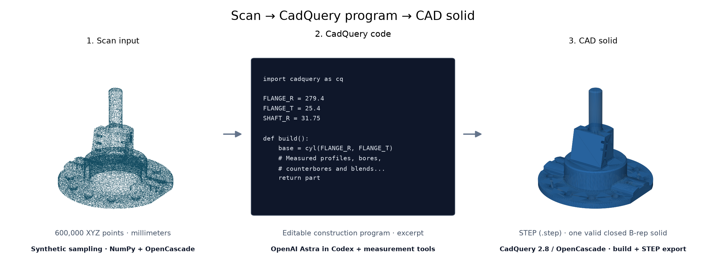
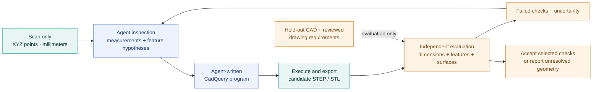

# Scan-to-CAD

### AI-generated engineering geometry, checked against measurable evidence

Reconstruct an editable mechanical CAD model from a scan, then independently check its features, dimensions, and surfaces. This experimental Python project explores how an AI agent can recover design intent while geometric tools measure the evidence and verify the result.



| Step | What was used | Role |
| --- | --- | --- |
| Scan input | NIST geometry; NumPy, trimesh, and CadQuery/OpenCascade | Generate the synthetic XYZ surface samples |
| Scan → CadQuery code | **OpenAI Astra in Codex**, with Python measurement tools | Inspect the scan, fit geometry, and write the construction program |
| CadQuery code → CAD solid | **CadQuery 2.8 / OpenCascade** | Execute modeling operations and export a closed STEP B-rep solid |

**Main study:** a scan-only agent reconstructed the NIST CTC-05 part as a valid, editable CadQuery solid. Independent comparison found **~0.003 mm surface error at the 95th percentile** in both directions. Main geometry is close; local engraving and blend differences still fail the strict benchmark.

[Case study](#main-study-scan-only-mechanical-reconstruction) · [Results](#independent-results) · [Reproduce](#reproduce-the-study) · [Workflow](#the-reverse-engineering-loop) · [Scope](#scope-and-next-steps)

## Motivation

Industrial components often need to be inspected, repaired, or reproduced without their original CAD. A scan captures their present surfaces; an engineering model also needs meaningful features, dimensions, and relationships. Wear and missing material make that distinction harder.

The goal is to recover useful, editable designs from physical observations. The current work starts with complete synthetic scans and held-out CAD before tackling physical scanning, partial observations, and damaged components. One close reconstruction is useful evidence, but does not establish general reliability or a model ranking.

## Main study: scan-only mechanical reconstruction

The part is **NIST CTC-05 Rev D**, a flanged shaft/housing-like test case with a rear cavity, counterbored bolt holes, mounting arms, an inclined support, blind side holes, chamfers, blends, and engraving. It is a mechanical geometry benchmark, not a documented drone component.

The reconstruction was produced using **OpenAI Astra in Codex** (user-attributed) in a separate chat with a **600,000-point XYZ scan in millimeters**. The supplied study notes state that only the scan was used as geometry evidence; the inspection scripts read that scan or arrays derived from it. Original CAD and drawing checks were applied afterward in this repository.

| Stage | Evidence and output |
| --- | --- |
| Input | Complete synthetic surface samples, with 0.005 mm Gaussian coordinate noise |
| Inspection | Scan projections, cross-sections, circle fits, planar levels, and local detail analysis |
| Reconstruction | Agent-written CadQuery program with named dimensions and explicit construction operations |
| Export | One valid solid in STEP; watertight STL reported by the study |
| Independent evaluation | Reopened STEP compared with held-out NIST CAD and one reviewed drawing size callout |

The agent wrote the reconstruction program itself. Geometric tools supplied measurements; CadQuery executed the construction.

### What the program reconstructs

- Flange with parallel flats and ten individually positioned counterbored bolt holes.
- Round housing with a chamfer and an underside blind cavity with a tapered entrance.
- Raised mounting arms, curved crowns, open recesses, and blind drill points.
- Curved upper support, inclined rear web, and six side blind holes.
- Shaft with top chamfer and root blend, plus other analytic fillets.
- Recessed engraving approximated by scan-derived polygonal outlines.

The reconstruction imposes symmetry, shared radii, and rounded nominal dimensions where the study considered them supported. These are design-intent assumptions, not a literal triangulation of noisy points. See the [editable program](examples/ctc05_scan_only/reconstruct.py) and [original reconstruction notes](examples/ctc05_scan_only/reconstruction_notes.md).

## Independent results

The supplied program was rebuilt successfully, its points array matched the fixed scan, and its exported STEP was independently compared with the original CAD. The evaluator uses physical solid geometry and **5,000 surface samples in each direction**.

| Check | Recorded result |
| --- | ---: |
| CAD validity / connected solids | **Valid / 1** |
| Reference-to-reconstruction surface distance, p95 | **0.00325 mm** |
| Reconstruction-to-reference surface distance, p95 | **0.00297 mm** |
| Maximum sampled bidirectional distance | **0.9895 mm** |
| Relative solid-volume difference | **0.00113%** |
| Overall extent differences | **Negligible** |
| Matched distinct cylindrical surfaces | **43 / 57** |
| Maximum diameter error among matched cylinders | **0.00006 mm** |
| Selected rear-bore drawing check | **Pass: 254 mm, within ±0.0254 mm** |
| Strict benchmark acceptance | **Rejected** |

**What remains wrong:** ten rounded engraving-stroke surfaces are represented with polygonal outlines, and four radius-6.35 blend-junction surfaces are not reproduced by the same analytic geometry. The 14 unmatched cylindrical surfaces are **not 14 missing drilled holes**. Local deviations still exceed the benchmark's 0.2 mm sampled maximum-distance threshold.

Small p95 and volume errors describe most of the reconstructed geometry; they do not erase local defects. This is sampled geometric evidence, not a whole-surface error bound or full datum-based GD&T certification. The drawing check covers one reviewed size callout, not every drawing requirement.

The [portable result snapshot](docs/assets/main-study-results.json) contains the independent evaluation evidence. The Astra attribution comes from the user; its exact checkpoint/model ID, reasoning setting, and complete generation-session trace were not captured with the supplied study; this is a case study, not a reproducible claim about a particular model version.

## Reproduce the study

Tested locally with **Python 3.12** and **CadQuery 2.8**. Use a Python version supported by CadQuery wheels for your platform.

```bash
python3.12 -m venv .venv
source .venv/bin/activate
python -m pip install -r requirements-cad.txt
```

### 1. Generate the reconstruction

Replay the saved agent-written CAD program; no scan or API key is required.

```bash
python examples/ctc05_scan_only/reconstruct.py \
  --output-dir outputs/replayed_scan_study
```

### 2. Verify against the reference

Independently compare the exported STEP with the held-out CAD and reviewed drawing callout.

```bash
python -m src.reverse_engineering evaluate \
  --candidate outputs/replayed_scan_study/reconstructed.step \
  --output outputs/replayed_scan_study/evaluation.json
```

### 3. Open the CAD solid

Open the preserved [STEP solid](examples/ctc05_scan_only/reconstructed.step), or use the file generated by the replay command.

Import `outputs/replayed_scan_study/reconstructed.step` into your CAD application. The STEP contains **one valid closed B-rep solid**, with analytic faces and millimeter units. CadQuery is the construction recipe; STEP is the resulting CAD solid and can be used without the Python code. Its geometric limitations are described in the results above.

The accompanying `reconstructed.stl` is a triangle mesh for mesh-based tools, rather than the B-rep solid.

Run the automated checks separately:

```bash
python -m pytest -q
```

This **replays the recorded construction**, including its measured parameters and approximations. It does not rerun the original agent or remeasure a different scan. The preserved program changes only output-directory/CLI handling from the supplied original; its construction geometry is unchanged.

The recorded full test run passed **99 tests** with optional model dependencies installed. The tiny neural-model interface test skips when those dependencies are absent. Automated tests do not make hosted model calls. One optional drawing-image test uses Poppler (`pdftoppm`).

### Repeat reconstruction from the scan

Generate the fixed-format input package separately:

```bash
python -m src.scan_package
```

The preserved [scan.ply](data/nist/ctc05/scan.ply) is ready to upload. Regenerating the package also creates the point-only folder `outputs/reverse_engineering/ctc05/input/`:

| File | Use |
| --- | --- |
| `scan.ply` | Portable binary point cloud for upload or inspection |
| `scan.xyz` | Plain XYZ coordinates |
| `scan_points_mm.npy` | NumPy point array |

Give a fresh agent only the scan, keeping reference CAD, drawings, existing programs, and previous results separate. For example:

> Reconstruct the uploaded mechanical scan as editable CadQuery Python code. Coordinates are in millimeters. Inspect and measure the point cloud using tools, identify its features, and write your own construction program. Execute it and export Python, STEP, and STL. Use only the uploaded scan; distinguish supported measurements from assumptions and report unresolved geometry. Finish the initial candidate before reference evaluation.

Then use the evaluator on the exported STEP and feed failed checks into subsequent attempts. For this study, the Codex agent owns reconstruction; the Python evaluator supplies downstream checks.

**Input scope:** the current scan is a complete-surface geometric sample, including hidden surfaces, rather than a physical optical-scanner simulation. Points are projected onto CAD surfaces before noise is added. The recorded scan also includes one loose auxiliary face present in the original STEP; it was not silently regenerated during evaluation. Future simulation should sample only physical solid surfaces.

## The reverse-engineering loop



The model drives reconstruction. Measurement tools help estimate dimensions from scan evidence; CadQuery builds the requested geometry; verification supplies downstream feedback. The reference is not a construction template. The main study's independent evaluation was performed after the submitted candidate; a fully automated general code-revision agent is not implemented by the repo commands.

The evaluator checks solid validity, cylindrical-surface correspondence, selected drawing dimensions, extents, volume, and sampled bidirectional surface distances. Its current development thresholds require one valid solid, no unmatched cylinder surfaces, selected callouts passed, extent errors ≤0.1 mm, relative volume error ≤0.1%, surface p95 ≤0.05 mm in both directions, and sampled maximum ≤0.2 mm. These thresholds are separate from manufacturing tolerances.

**Evaluator correction:** the reference STEP contains a closed **208-face solid plus one loose auxiliary face**. Including that loose face in mass properties inflated the reference volume by about 1%. The current evaluator selects solid geometry and uses adaptive volume integration. The results above use the corrected evaluator.

## Outputs and code map

The study's scan, program, STEP solid, STL, notes, figures, and evaluation are preserved outside ignored `outputs/` so they remain inspectable in a fresh checkout. Runtime diagnostics and downloaded weights remain local.

```text
examples/ctc05_scan_only/
├── reconstruct.py               # Preserved agent-written CAD construction
├── reconstructed.step           # Ready-to-open CAD solid
├── reconstructed.stl            # Surface mesh
└── reconstruction_notes.md      # Measurements, assumptions, unresolved details

docs/assets/
├── main-study.png
└── main-study-results.json       # Independent evaluation evidence

outputs/replayed_scan_study/      # Created by the replay command
├── reconstructed.step
├── reconstructed.stl
└── evaluation.json
```

| Module | Responsibility |
| --- | --- |
| [`src/scan_package.py`](src/scan_package.py) | Projected CAD-surface point sampling and portable scan-only exports |
| [`src/cad_evaluation.py`](src/cad_evaluation.py) | Held-out STEP inventory, dimensions, volume, and sampled surface comparisons |
| [`src/reverse_engineering.py`](src/reverse_engineering.py) | Separate reconstruction and evaluation commands |
| [`tests/`](tests/) | Geometry, execution boundaries, rejection cases, and evaluator regressions |

CadQuery/OpenCascade constructs and exports the CAD solid. The scan is inspected and measured using Python tools.

## Scope and next steps

The main study demonstrates a detailed reconstruction on **one complete synthetic scan**. It does not establish performance across arbitrary parts, physical scans, partial observations, damage, or unknown poses. Reconstruction code and measurements are editable, but the archived study is not a general automatic fitter for every uploaded part.

Next experiments are to resolve the engraving and blend residuals without degrading verified features, capture model identity and complete tool traces, automate feedback-driven CAD-code revisions, and repeat the study on additional parts. Physical-scanner viewpoints, occlusion, registration, and wear belong in later tests once the complete-scan baseline is reliable.

### Dataset provenance

NIST supplies the original CTC-05 and FTC-11 STEP files and annotated drawings. See [CTC-05 provenance](data/nist/ctc05/provenance.json), [FTC-11 provenance](data/nist/ftc11/provenance.json), and the [NIST download page](https://www.nist.gov/ctl/smart-connected-systems-division/smart-connected-manufacturing-systems-group/mbe-pmi-0). We acknowledge NIST; no endorsement is implied. These are PMI test cases, not examples of recommended GD&T practice.

Five simpler reference parts are procedurally generated in this project. No real scanner dataset or downloaded Onshape model is bundled. Synthetic sampling and evaluation assumptions are recorded with each experiment.

<details>
<summary>Regenerate the main-study visuals</summary>

```bash
python scripts/render_main_study.py
```

This reads the recorded local study from `outputs/reconstruction_scan/` when available, or the preserved scan, CAD, and evaluation in the repository. It makes no model calls.

</details>
