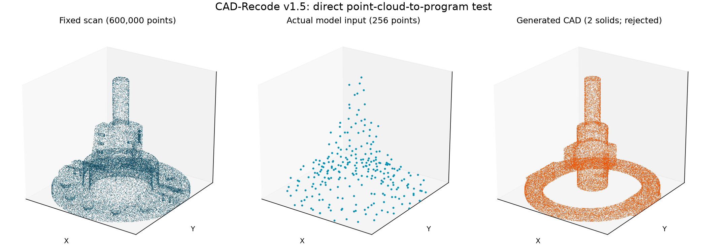

# Direct point-cloud-to-CAD reconstruction

CAD-Recode v1.5 is now the default `reverse_engineering reconstruct` backend.
It consumes sampled XYZ points and generates a CadQuery Python program. The
previous cylinder-only baseline remains available with `--backend cylinder`.
The old live shaft-repair experiment is retained separately for comparison.

## Setup and run

```bash
.venv/bin/python -m pip install -r requirements-recode.txt
.venv/bin/python scripts/download_recode.py
.venv/bin/python -m src.cad_recode
```

The last command generates a candidate from the fixed CTC-05 scan and then
performs the existing held-out CAD/drawing comparison. The equivalent separated
commands are:

```bash
.venv/bin/python -m src.reverse_engineering reconstruct \
  --scan outputs/reverse_engineering/ctc05/input/scan_points_mm.npy \
  --output-dir outputs/reverse_engineering/ctc05/cad_recode
.venv/bin/python -m src.reverse_engineering evaluate \
  --candidate outputs/reverse_engineering/ctc05/cad_recode/candidate.step \
  --output outputs/reverse_engineering/ctc05/cad_recode/evaluation.json
```

CPU inference is supported. `--device auto` selects CUDA, then Apple MPS when
available, then CPU. This workspace's sandbox exposes CPU. No hosted model API
or scan upload is used. The approximately 3 GB checkpoint is downloaded once to
ignored `outputs/models/`; pinned Hugging Face revisions are recorded by the
download script. No remote Python model code is executed during loading.

## Data boundary and units

Only the fixed scan goes into point preparation and inference. The scan's
bounding-box center is subtracted, and half its longest extent is the length
scale. An 8,192-point deterministic candidate subset is reduced to **256 points**
with farthest-point sampling, following the upstream model input size.
The selected normalized points and inverse transform are preserved.

CAD-Recode outputs CAD coordinates at 100 times the normalized point coordinates.
The generated solid is therefore scaled by `scale_mm / 100` and translated by
the saved center. No alignment or size correction uses the reference CAD.
Reference geometry is opened only by evaluation after candidate export.

The restricted executor accepts straight-line CadQuery operations and numeric
expressions. It rejects file imports, arbitrary Python imports, introspection,
loops, and unsupported attributes. Execution runs in a separate process with
API credentials omitted and a 90-second timeout. This is a syntax restriction
and process boundary, not an OS security sandbox. Unsupported generated syntax
is reported as a failed attempt, not silently rewritten into a working model.

## Artifacts and reproducibility

Each attempt saves normalized input points, transform, raw generation metadata,
`generated.py`, execution logs, candidate STEP/STL when valid, and evaluation.
Programs must assign their resulting CAD object to `r`, as in the upstream demo.
Truncated generations without EOS are retained but not executed.

Offline replay of a saved program does not run the model:

```bash
.venv/bin/python -m src.cad_recode \
  --program-file outputs/reverse_engineering/ctc05/cad_recode/generated.py \
  --output-dir outputs/reverse_engineering/ctc05/cad_recode_replay
```

The generated-code backend removes the fixed-envelope restriction. It does not
yet implement an LLM code-revision agent driven by evaluator feedback. CAD-Recode
is a point-cloud-conditioned initial generator; the earlier strategy-only loop
should not be mistaken for such a code editor.

## Limitations and license

256 points are a substantial information bottleneck for this 209-face part.
Small holes, lettering, blends and complex surfaces may be omitted. The model
learned a sketch/extrusion code representation; a more expressive interface alone
does not guarantee faithful reconstruction or drawing tolerances. The evaluator
retains the same acceptance criteria and reports failed geometry explicitly.

Upstream implementation and checkpoint are under **CC BY-NC 4.0**, including a
noncommercial restriction. The original notebook, license, and attribution are
in `third_party/cad_recode/`; adapted model code preserves the point encoder and
adds CPU/MPS dtype and attention-mask handling. It does not use Open3D or
PyTorch3D. NumPy implements farthest-point sampling.

Sources: [official CAD-Recode repository](https://github.com/filaPro/cad-recode),
[paper](https://arxiv.org/abs/2412.14042), and
[checkpoint](https://huggingface.co/filapro/cad-recode-v1.5).

## Recorded first local run

The actual checkpoint ran on CPU and generated 380 tokens in 113.5 seconds.
Its unchanged Python program executed and exported STEP/STL. The integration's
first syntax check lacked the legitimate Sketch `face` and `reset` methods; the
allowlist was corrected and the same generation replayed without another model
call. This is recorded in the report.

| Check | Previous constrained closed model | CAD-Recode v1.5 |
|---|---:|---:|
| Solid count | 1 | 2 |
| Reference-to-candidate surface p95 | 25.31 mm | 66.67 mm |
| Candidate-to-reference surface p95 | 24.58 mm | 47.66 mm |
| Relative volume error | 6.26% | 45.05% |
| Selected bore size check | Pass | Fail: matching bore missing |
| Accepted | No | No |



The first learned reconstruction is worse on this part. The code generator
supports more than the previous fixed template, but the model input loses much
of the scan detail and predicted dimensions are inaccurate. No automatic
nominal snapping, reference alignment, or hidden correction was applied.
This is one deterministic generation, not a benchmark ranking of model families.

The [recorded result](assets/cad-recode-results.json) includes model revisions,
input hash, raw generation, execution status, and evaluator output. The generated
Python and STEP are under `outputs/reverse_engineering/ctc05/cad_recode/`.
