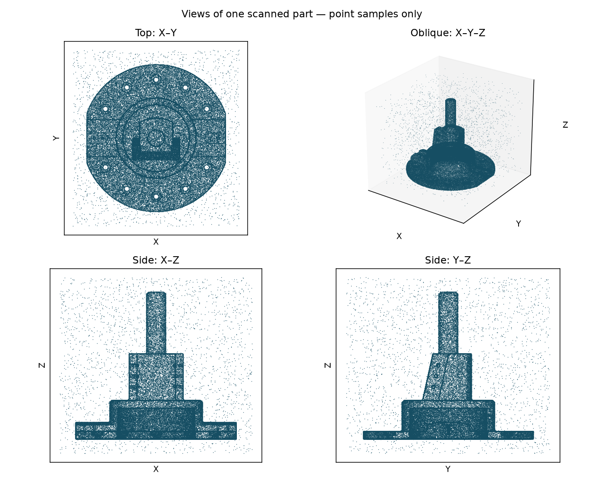
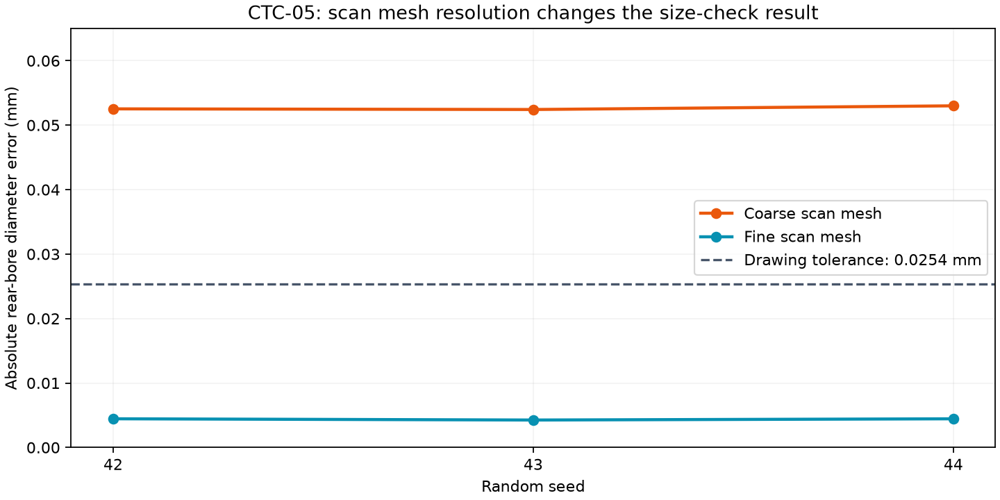

# NIST CTC-05: a realistic geometry challenge

CTC-05 Rev D is a flanged shaft/housing-like test part from NIST's MBE PMI
collection. It has 209 CAD faces, including counterbores, cross-drilled holes,
noncircular features, blends, and a rear cavity. Its scale is substantial: the
flange's nominal cylindrical diameter is 558.8 mm. This is an actuator-like
geometry benchmark, not a documented drone component.

NIST supplies the source geometry and drawing. The unchanged archive members,
checksums, and acknowledgement are in `data/nist/ctc05/provenance.json`.
The source PDF has two annotated isometric views, rather than a conventional
fully dimensioned manufacturing drawing. The visibly reviewed rear-bore callout
on page 2 is diameter 10.000 +/- 0.001 inches (254 +/- 0.0254 mm).
Most nominal dimensions require the CAD. GD&T is not evaluated.

## Run

```bash
.venv/bin/python -m src.ctc05_experiment
.venv/bin/python -m pytest -q
```

Each of three seeds is sampled at two tessellation resolutions, with 120,000
surface points, 0.03 mm Gaussian noise, and 2% replacement outliers. Full-surface
sampling includes hidden surfaces and does not model scanner occlusion.
The finer-resolution experiment audits simulator fidelity; it is not an
AI correction or an autonomous reconstruction correction.

## What is recovered

The scan-only fitter uses local PCA normals and circle RANSAC to discover
supported Z-aligned cylindrical patches. It receives no drawing dimensions,
reference CAD, part ID, feature count, or part-specific bounding regions.
The main flange, hub, shaft, and rear bore are recovered. Axial bounds are
sample quantiles and must not be interpreted as measured shoulder locations.

Exported `cylindrical_patches.step` files contain independent open cylindrical
faces. They are deliberately not exported or accepted as complete solid CAD.
Holes, counterbores, flats, blends, and cavity closure remain unresolved.

The reference is opened after feature extraction and export for matching and
diameter error evaluation. The drawing bore check uses this CAD-assisted
association. Autonomous drawing-to-scan correspondence is not demonstrated.
No AI call is executed by this benchmark: the existing plate-only interpretation
schema does not describe this topology adequately.

## Why scan mesh resolution matters

The original 0.02 mm / 0.1 rad tessellation makes circular surfaces polygonal.
Fitting those samples biases radii inward. The rear bore fails its tight size
check even though the synthetic source CAD has the correct nominal diameter.
At 0.002 mm / 0.03 rad the bias falls substantially. Both parameter sets and
all results are preserved in `outputs/nist/ctc05/report.json`.





**Outcome: partial feature recovery; full reconstruction rejected.** Passing a
selected diameter check does not establish a correct complete part.
