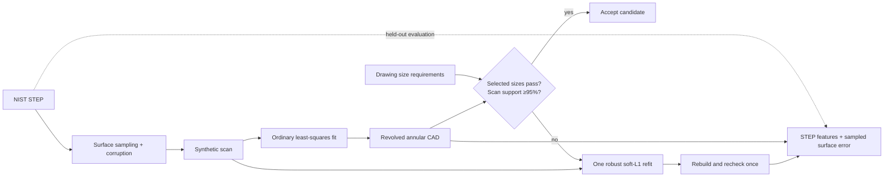

# NIST drawings as a verification loop

This experiment adds an externally sourced part, synthetic scan corruption, selected drawing-size checks, and a bounded geometric correction. It uses **NIST FTC-11, Rev B**, an annular component with raised rounded rims. It is a constrained reconstruction experiment, not an automatic parser or reconstructor for all NIST test cases.

## Sources and provenance

The [NIST MBE PMI collection](https://www.nist.gov/ctl/smart-connected-systems-division/smart-connected-manufacturing-systems-group/mbe-pmi-0) provides geometry and drawings for FTC/CTC/STC parts. NIST states that its test cases, CAD models, and STEP files can be used without restrictions, with acknowledgement requested and no endorsement implied. Its FTC and CTC examples exercise valid PMI presentations and are not intended to demonstrate best-practice GD&T strategies.

The original FTC-11 [drawing](../data/nist/ftc11/drawing.pdf) and [STEP geometry](../data/nist/ftc11/reference.step) are included unchanged. Their original archive members, download URL, SHA-256 checksums, and reuse statement are recorded in [provenance.json](../data/nist/ftc11/provenance.json). Large downloaded archives and intermediate outputs are ignored.

## Selected checks

The values below were visually transcribed from the two drawing pages into [drawing_checks.json](../data/nist/ftc11/drawing_checks.json), independently of the STEP geometry.

| Drawing size | Nominal | Symmetric tolerance | Page |
| --- | ---: | ---: | ---: |
| Average outside diameter | 63 mm | ±0.5 mm | 1 |
| Average inside diameter | 32 mm | ±0.3 mm | 1 |
| Two rim radii | 1.5 mm | ±0.04 mm | 1 |
| Central web thickness | 1.93 mm | ±0.08 mm | 2 |

The STEP's central web measures **1.925 mm**, while the rounded rims make the maximum overall height **3 mm**. Neither quantity should be silently substituted for the drawing's 1.93 mm nominal. Average-diameter checks use fitted-cylinder diameters as proxies. The known model family constrains the two rims to share a radius, so this experiment does not independently qualify each rim.

Roundness, flatness, datum-based profile, free-state behavior of the non-rigid part, and the R0.1 MAX transition callouts are **not evaluated**. Passing these four size checks is not full drawing compliance or manufacturing qualification.

## Reproduce locally

With the existing CAD environment installed:

```bash
python -m src.nist_experiment
```

The default experiment samples 30,000 surface points from the source STEP, adds Gaussian noise with sigma **0.01 mm**, and replaces **2%** of samples with random outliers. It records the seed, input checksum, sampling method, corruption settings, and retained point count. For this known annular family, sampling is area-weighted directly on the analytic CAD surfaces; other STEP geometries use a recorded tessellation fallback.

This is synthetic surface sampling. It does not simulate optical visibility, calibrated scanner errors, real sensor measurements, or manufacturing variation. Optional random dropout is not a physical model of missing views.

```bash
python -m src.nist_experiment \
  --seed 43 --noise-mm 0.01 --outliers 0.02 \
  --output-dir outputs/nist/ftc11_seed43

# Sample another STEP file without claiming reconstruction support for it.
python -m src.synthetic_scan path/to/part.step \
  --points 30000 --noise-mm 0.01 --outliers 0.02 --dropout 0.05 \
  --output-dir outputs/another_scan
```

## Reconstruction and correction



The family assumes a complete Z-aligned annulus with two cylindrical walls, two planes, and two circular-section raised rims. From scan points alone, the fitter estimates the common XY center, bore/outside diameters, bottom/web/shoulder elevations, and rim radius. It then constructs a revolved CadQuery profile and exports STEP/STL.

When selected sizes or surface support fail, the system retries the same scan with robust soft-L1 fitting. **No nominal drawing sizes are passed to either fitter, and no dimensions are snapped to nominal.** There are at most two geometric attempts. A genuinely incompatible size must remain a failure after refitting.

Each iteration retains its CAD, parameters, individual checks, failed dimensions, and scan support. Held-out evaluation reopens both STEP files, extracts their analytic surface parameters, and computes sampled distances in both directions to the corresponding analytic surfaces. Evaluation samples are area-weighted directly on analytic surfaces, with their total area checked against the imported CAD. Sample counts and seeds are reported. These sampled maxima are not full Hausdorff bounds. Evaluation uses new seeds and clean surfaces, independently of the noisy scan points.

Near-coincident trimmed tori produced unreliable OpenCascade Boolean intersections during development, including impossible IoU values. This experiment therefore uses feature and sampled-surface errors rather than reporting Boolean IoU. The existing plate benchmark's verification is unchanged.

## Optional live drawing interpretation

Install **Poppler** (`pdftoppm`) for rendering the two-page drawing. With the existing `.env` and model configuration:

```bash
python -m src.nist_experiment --live-drawing \
  --output-dir outputs/nist/ftc11_live
```

The model receives only drawing-page PNGs, not the reference STEP, scan-derived dimensions, or reviewed expected values. Its structured transcription is checked against the independently reviewed units, nominal values, tolerances, and page references. Free-text qualifiers are preserved but not semantically certified.

If that check fails, one corrective call includes enlarged, manually located callout crops and the names of failed fields. Feedback does not include the correct numerical values. Incorrect or uncertain transcription after this retry blocks the scan experiment. Each fresh run permits at most two hosted calls, with automatic SDK retries disabled, a 1,800-token output cap, and the configured timeout. A resumed first response permits at most one new corrective call. These settings are separate from the original scan-interpretation CLI.

Resume a recorded first response without paying for the first call again:

```bash
python -m src.nist_experiment --live-drawing \
  --drawing-response outputs/nist/ftc11_live/drawing_response.json \
  --output-dir outputs/nist/ftc11_retry
```

Without `--live-drawing`, `--drawing-response` replays an already saved transcription with no hosted request. The report records replay/live/reviewed modes explicitly. The reviewed drawing path is a deliberate, separate experiment; it never masquerades as an accepted AI transcription.

### Observed model limitation

On the initial live Qwen3-VL-8B run, the model read the four nominal values but returned zero for all four tolerances and confused web thickness with overall height. One cropped corrective attempt still returned zero tolerances and unresolved uncertainties. Both attempts were blocked. Their responses are retained under `outputs/nist/ftc11_live/` and `outputs/nist/ftc11_live_corrected/`.

This establishes a working verification boundary and an important failure case. It does **not** establish reliable autonomous engineering-drawing interpretation or AI-driven geometric correction. The geometric correction demonstrated here is deterministic, using the reviewed drawing requirements.

## Outputs

`outputs/nist/ftc11/report.json` records the complete local experiment. The `scan/` subfolder contains point arrays and metadata; `iteration_0/` and, when needed, `iteration_1/` contain exported CAD and measured parameters. Live runs also save rendered drawing pages, callout crops, raw responses, request schemas/prompts, and available token usage/cost.

The report's `accepted` flag refers only to the selected drawing checks and scan support. Held-out surface errors and the explicit `not_evaluated` list must be reviewed separately.
