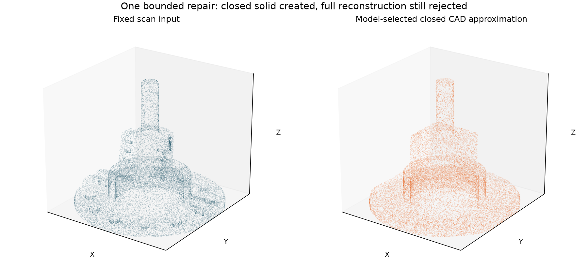

# Scan input for the reverse-engineering loop

The CTC-05 benchmark now has a fixed, portable scan input suitable for developing
and testing reconstruction. The scan-generation fidelity problem is addressed;
complete CAD reconstruction remains an algorithm-development task.

## Use these inputs

`outputs/reverse_engineering/ctc05/input/` contains only:

- `scan.ply`: binary point cloud, readable by point-cloud and CAD tools.
- `scan.xyz`: plain XYZ coordinates.
- `scan_points_mm.npy`: NumPy point array for the Python reconstruction path.
- `README.txt`: coordinate units and input scope.

All three point formats represent the same 600,000 points in millimeters. The
PLY contains points only, not a tessellated reference mesh. There are no face
labels, nominal dimensions, or reference CAD files in the reconstruction input.
Use this folder alone when giving a reconstruction agent its scan input.

## Fidelity

Fine mesh samples are projected onto their original CAD surfaces. Each accepted
projection is checked against the face's trimming boundaries. This removes
polygonal faceting from point positions while retaining all 209 source faces.
Every face receives at least 250 points, with remaining samples allocated by
area. This deliberate oversampling of small surfaces is useful for the initial
algorithm benchmark; it is not uniform scanning density.

The recorded source-surface residual before noise is below 1e-9 mm. Gaussian
coordinate noise has standard deviation 0.005 mm; 95% of noise displacements
are below 0.0141 mm. No outliers are added to this initial benchmark. The quality
report and noiseless samples live under `evaluation/`, outside the input folder.

This is a complete-surface geometric oracle, including hidden cavities. It is
intentionally an easier benchmark than physical scanning. Visibility, sensor
calibration, missing views, and registration can be added after reconstruction
works on the complete input. Coordinate axes currently match source CAD; general
pose estimation is outside this baseline.

## Run each stage separately

Generate once, then keep the scan fixed across reconstruction attempts:

```bash
.venv/bin/python -m src.scan_package
```

The existing baseline consumes points only:

```bash
.venv/bin/python -m src.reverse_engineering reconstruct --backend cylinder \
  --scan outputs/reverse_engineering/ctc05/input/scan_points_mm.npy \
  --output-dir outputs/reverse_engineering/ctc05/attempt_0
```

Replace that baseline with a reconstruction agent or another CAD tool, and save
its output as a STEP file. The evaluator accepts that STEP independently:

```bash
.venv/bin/python -m src.reverse_engineering evaluate \
  --candidate outputs/reverse_engineering/ctc05/attempt_0/candidate.step \
  --output outputs/reverse_engineering/ctc05/attempt_0/evaluation.json
```

Evaluation opens the candidate and held-out original STEP. It reports:

- One-to-one cylinder association, diameter errors, axis offsets, and missing or
  extra cylindrical surfaces. Split faces with identical cylinder geometry are
  deduplicated. These are geometric surfaces, not semantic feature labels;
  several small surfaces belong to modeled lettering.
- The reviewed drawing rear-bore callout: diameter 10.000 +/- 0.001 inches,
  converted to 254 +/- 0.0254 mm. Its association currently uses held-out CAD.
- Overall extents, solid validity, volume error, and bidirectional sampled surface
  distances to fine tessellations (5,000 samples in each direction).

Selected benchmark acceptance requires one valid solid, all reference cylinders
matched, no extra cylinders, the selected drawing check passed, extent errors
at most 0.1 mm, relative volume error at most 0.1%, bidirectional surface p95 at
most 0.05 mm, and sampled maximum distance at most 0.2 mm. These are development
thresholds, not drawing tolerances or full GD&T certification. A candidate can
pass this sampled benchmark without proving conformance everywhere.

Feed failed feature/dimension checks into the next reconstruction attempt while
retaining the same scan. Evaluator feedback is downstream evidence; do not give
the reconstructor the original STEP or noiseless evaluation points. No automated
AI repair is currently executed by these commands.

## Recorded first attempt

The scan-only cylinder baseline recovered 12 cylindrical patches. Its rear-bore
diameter is 254.000025 mm, passing the selected size callout. It misses 45 of 57
distinct reference cylindrical surfaces, as well as planes, blends, and solid
topology. The reference-to-candidate sampled p95 distance is about 83.95 mm.
The evaluator correctly rejects this candidate as a complete CAD model.

This result establishes a usable scan and an executable comparison boundary.
It does not claim the current cylinder-only algorithm can reconstruct CTC-05.
See `outputs/reverse_engineering/ctc05/attempt_0/evaluation.json` for full evidence.

## Live bounded repair run

A live Qwen3-VL-8B run now exercises one repair on the fixed scan. The first call
abstained because it conflated off-axis patches with the coaxial group. One
clarification grouped scan measurements into four coaxial cylinders and the
remaining off-axis patches. The second call selected the implemented
`build_scan_fitted_shaft_envelope` strategy. Both responses are preserved.

The model selects a strategy from an allowlist; it does not write or execute CAD
code. Numeric fitting and CAD construction are deterministic. The repair receives
only the scan and scan-fitted cylinders. Model inputs are scan views, those
measurements, and categorical failed checks, without reference CAD, drawing
images, or reference dimension values. The model's prose labels are hypotheses,
not verified feature classifications.

The builder fits supported Z plane modes for axial levels, unions flange/hub,
rectangular upper-body and shaft solids, and cuts the measured rear bore. The
upper body, shoulder transitions, and flange clipping are approximations.
It produces a valid single closed solid but omits mounting holes, blends,
chamfers and the true tapered upper-body shape.

| Measurement | Initial open patches | Repaired closed solid |
|---|---:|---:|
| Valid solid count | 0 | 1 |
| Reference-to-candidate surface p95 | 83.95 mm | 25.31 mm |
| Candidate-to-reference surface p95 | 6.78 mm | 24.58 mm |
| Sampled maximum surface distance | 112.63 mm | 35.93 mm |
| Missing distinct cylinder surfaces | 45 of 57 | 53 of 57 |
| Relative volume error | Not applicable | 6.26% |
| Selected bore size check | Pass | Pass |
| Accepted | No | No |

The initial patches include some off-axis cylindrical features that the closed
approximation omits, so several metrics worsen. This is a mixed result, not
successful reconstruction or proof that AI improves geometry. The model only
chooses between one implemented repair and abstention. Actual hosted-call costs
were $0.0010445 + $0.00113075 = $0.00217525.



Run a new live attempt (uses the configured model API):

```bash
.venv/bin/python -m src.shaft_loop
```

If it abstains, one manually requested clarification can supply the deterministic
coaxial grouping while preserving the previous response:

```bash
.venv/bin/python -m src.shaft_loop \
  --previous-decision outputs/reverse_engineering/ctc05/live_loop/repair_decision.json \
  --output-dir outputs/reverse_engineering/ctc05/live_loop_clarified
```

Replay the recorded selected strategy offline, with no hosted model request:

```bash
.venv/bin/python -m src.shaft_loop \
  --decision-file outputs/reverse_engineering/ctc05/live_loop_clarified/repair_decision.json \
  --output-dir outputs/reverse_engineering/ctc05/replayed_loop
```

Recorded evidence is in [the portable result snapshot](assets/shaft-loop-results.json).
The candidate is at
`outputs/reverse_engineering/ctc05/live_loop_clarified/attempt_1/candidate.step`.
